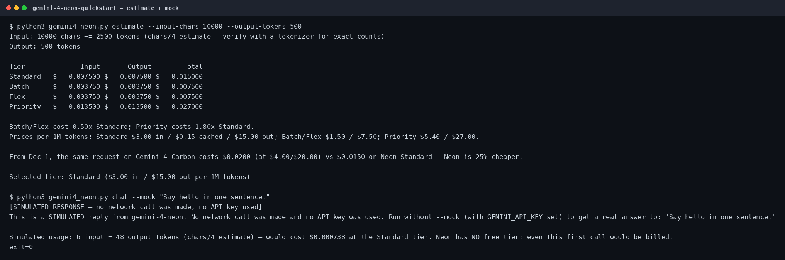

# gemini-4-neon-quickstart

**Try Google's brand-new Gemini 4 Neon in 30 seconds — no API key, no network, no pip installs — and see before you spend a cent that there is NO free tier: your very first call is already billed, and a 10,000-char prompt + 500 output tokens costs $0.0150.**

A zero-dependency Python CLI for Gemini 4 Neon (`gemini-4-neon`). Run a simulated chat with no key, preview the exact JSON request body before anything is sent, and price every request across all four tiers (Standard / Batch / Flex / Priority) — plus a Neon-vs-Carbon comparison for the Dec 1 price change. Stdlib only, Python 3.8+.

## Why now

- **Gemini 4 Neon went generally available 2026-11-18** — the newest member of the Gemini 4 family, announced by Koray Kavukcuoglu on Google's blog. Model ID `gemini-4-neon`. Same request schema as the rest of the family, so switching model IDs needs no code change.
- **The price is the story — there is no free tier.** Every token is billed, thinking tokens included. The first call already costs money, so check the price first: a 10,000-char prompt + 500 output tokens costs **$0.0150 on Standard, $0.0075 on Batch/Flex, $0.0270 on Priority**.
- **Dec 1 is a price inflection.** Carbon and Argon's intro price ($2/$10) ends Nov 30; from Dec 1 Carbon costs $4/$20 — so Neon ($3/$15) becomes **25% cheaper than Carbon** for the same request. If you are choosing between the two, that flips the default.
- **Big context, four thinking levels**: 1,048,576-token context window (unified input + thinking + output), thinking levels `low` / `medium` / `high` / `xhigh` (default `high`), knowledge cutoff March 2026, up to 65,536 output tokens per synchronous segment (up to 1M with background long decode).

Sources: [Google blog — Introducing Gemini 4 Neon, 2026-11-18](https://blog.google/innovation-and-ai/models-and-research/gemini-models/introducing-gemini-4-neon/) · [Gemini API pricing](https://ai.google.dev/gemini-api/docs/pricing)

## Quick start (30 seconds, offline)

```bash
git clone https://github.com/Mahgal/gemini-4-neon-quickstart.git
cd gemini-4-neon-quickstart
python3 gemini4_neon.py chat --mock "Say hello in one sentence."
```

No install step — there are no dependencies. Python 3.8+ is all you need. Verified from a clean checkout on 2026-11-19 (no key, no network, exit 0).

## Usage

```bash
# 1. Mock chat (default demo path): prints the exact request JSON + a
#    clearly-labelled SIMULATED reply with token accounting and its cost.
#    No network, no API key. Exit 0.
python3 gemini4_neon.py chat --mock "Say hello in one sentence."
python3 gemini4_neon.py chat --mock --thinking-level low "Say hello."

# 2. Live call: needs your own Gemini API key (paid tier — NO free tier).
export GEMINI_API_KEY=<your-key>
python3 gemini4_neon.py chat "Explain quantum computing in one sentence."
python3 gemini4_neon.py chat --live --thinking-level xhigh --max-output-tokens 2048 "Hard question..."

# 3. Cost estimator: all four tiers side by side + the Carbon Dec-1
#    comparison, no network. Exit 0.
python3 gemini4_neon.py estimate --input-chars 10000 --output-tokens 500
python3 gemini4_neon.py estimate --input-chars 400000 --output-tokens 2000 --cached
python3 gemini4_neon.py estimate --input-chars 10000 --output-tokens 500 --thinking-tokens 2000
```

Options: `--thinking-level low|medium|high|xhigh` (default `high`),
`--max-output-tokens` (default 1024), `--tier standard|batch|flex|priority`
(estimator table always shows all four), `--cached` (price input at the
cached-input rate), `--thinking-tokens` (thinking is billed at the output rate).
`--mock` also works before the subcommand: `python3 gemini4_neon.py --mock chat "..."`.

Exit codes: `0` success · `1` API call failed · `2` bad arguments or missing `GEMINI_API_KEY`.
A missing key prints a clear message telling you to `export GEMINI_API_KEY=...` — your key is never printed or stored by this tool. It also warns you that Neon has no free tier.

## Example output

Real output of the two commands in [demo.txt](demo.txt), captured verbatim on 2026-11-19 (no key, no network):

```
$ python3 gemini4_neon.py chat --mock --thinking-level high "Say hello in one sentence."
Request JSON (would be sent to https://generativelanguage.googleapis.com/v1beta/models/gemini-4-neon:generateContent):

{
  "model": "gemini-4-neon",
  "contents": [
    {
      "parts": [
        {
          "text": "Say hello in one sentence."
        }
      ]
    }
  ],
  "generationConfig": {
    "thinkingConfig": {
      "thinkingLevel": "high"
    },
    "maxOutputTokens": 1024
  }
}

[SIMULATED RESPONSE — no network call was made, no API key used]
This is a SIMULATED reply from gemini-4-neon. No network call was made and no API key was used. Run without --mock (with GEMINI_API_KEY set) to get a real answer to: 'Say hello in one sentence.'

Simulated usage: 6 input + 48 output tokens (chars/4 estimate) — would cost $0.000738 at the Standard tier. Neon has NO free tier: even this first call would be billed.
exit=0

$ python3 gemini4_neon.py estimate --input-chars 10000 --output-tokens 500
Input: 10000 chars ~= 2500 tokens (chars/4 estimate — verify with a tokenizer for exact counts)
Output: 500 tokens

Tier              Input       Output        Total
Standard   $   0.007500 $   0.007500 $   0.015000
Batch      $   0.003750 $   0.003750 $   0.007500
Flex       $   0.003750 $   0.003750 $   0.007500
Priority   $   0.013500 $   0.013500 $   0.027000

Batch/Flex cost 0.50x Standard; Priority costs 1.80x Standard.
Prices per 1M tokens: Standard $3.00 in / $0.15 cached / $15.00 out; Batch/Flex $1.50 / $7.50; Priority $5.40 / $27.00.

From Dec 1, the same request on Gemini 4 Carbon costs $0.0200 (at $4.00/$20.00) vs $0.0150 on Neon Standard — Neon is 25% cheaper.

Selected tier: Standard ($3.00 in / $15.00 out per 1M tokens)
exit=0
```

The mock reply is simulated — it is labelled SIMULATED in the output, and it is not a real model response. A live call prints the real reply plus its token usage and estimated cost.

## Pricing (per 1M tokens, paid tier)

| Tier | Input | Cached input | Output | vs Standard |
|---|---|---|---|---|
| Standard | $3.00 | $0.15 | $15.00 | 1.0x |
| Batch | $1.50 | $0.075 | $7.50 | 0.5x |
| Flex | $1.50 | $0.075 | $7.50 | 0.5x |
| Priority | $5.40 | $0.27 | $27.00 | 1.8x |

**Rule of thumb:** default to Standard; use Batch/Flex when the request can wait and you want it at half price; use Priority only when latency is worth 1.8x. Run `estimate` first — it shows all four prices before you spend anything.

**No free tier.** Unlike some Gemini models, Neon bills every token from the first call, thinking tokens included. The estimator prices thinking tokens at the output rate (`--thinking-tokens`).

Note on cached rates: Google publishes the $0.15 cached-input rate for Standard. The Batch/Flex ($0.075) and Priority ($0.27) cached rates shown here are that $0.15 scaled by the same 0.5x / 1.8x tier multiplier Google applies to input/output — verify on the [pricing page](https://ai.google.dev/gemini-api/docs/pricing) before relying on them for billing.

## The Gemini 4 lineup

| Model | GA date | Input / 1M | Output / 1M |
|---|---|---|---|
| Argon | Oct 13 | — | — |
| Carbon | Nov 10 | $2.00 intro → **$4.00 from Dec 1** | $10.00 intro → **$20.00 from Dec 1** |
| Hydrogen | Nov 12 | $1.50 | $7.50 |
| **Neon** | **Nov 18** | **$3.00** | **$15.00** |

From Dec 1, Neon ($3/$15) is 25% cheaper than Carbon ($4/$20) for the same request. Same request schema across the family: switching model IDs needs no code change.

## How the estimate works

Input tokens are estimated as `chars / 4` — an approximation, stated in the output. Real token counts depend on the text; verify with a tokenizer for exact billing. Cached input uses the cached-input rate (`--cached`). The estimator is pure arithmetic: no network, deterministic, same input always gives the same table.

## Honest limits

- **No live call was made while building this quickstart** — there was no `GEMINI_API_KEY` in this environment. The `--mock` and `--estimate` paths are fully real and tested (42 tests, exit 0); the `--live` path is code-reviewed only and has not been verified against the real API. The README never claims a live call succeeded.
- No model-page docs URL is linked here: the `/gemini-api/docs/models/gemini-4-neon` page was returning 404 on 2026-11-18. Only the two URLs above were verified.
- Thinking-level values (`low` / `medium` / `high` / `xhigh`) are sent in the request JSON exactly as named; the exact enum casing the live API expects has not been verified against a live call.

## Tests

```bash
python3 -m unittest discover -s tests -v
```

42 tests, stdlib `unittest` only. They cover the worked pricing example by hand (Standard $0.0150, Batch $0.0075, Priority $0.0270 for 2,500 in + 500 out tokens), tier multipliers (0.5x / 1.8x), cached-input rates, thinking tokens billed at the output rate, the Carbon Dec-1 comparison (Neon 25% cheaper), thinking-level validation (all four valid, anything else rejected), request-JSON shape (model id, `contents`, `thinkingConfig`), estimate determinism, mock determinism and the SIMULATED label, and the missing-key error path (exit 2).

## License

MIT — see [LICENSE](LICENSE).
